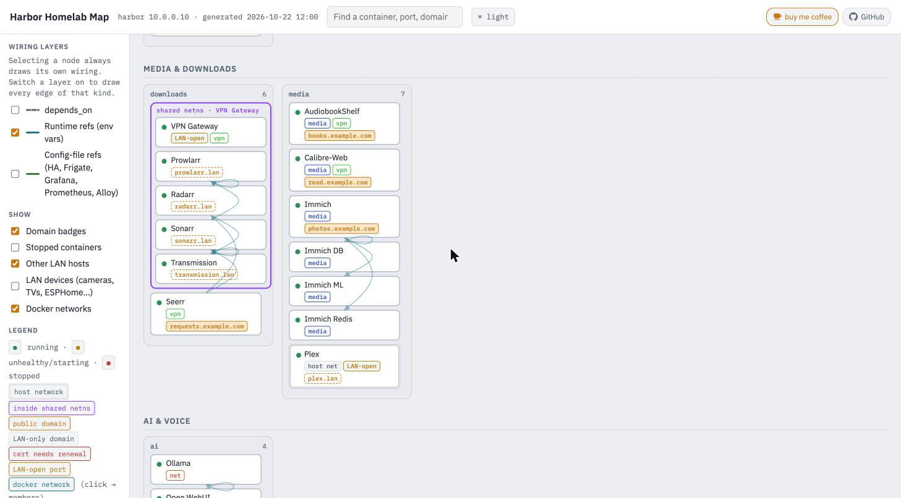

# Wharfmap

Wharfmap draws a map of a Docker host. It asks Docker what's running, reads your reverse proxy
to see which domain goes where, and renders the whole thing as one HTML page: every container,
network, published port, and the wiring between them.

I built it for my own homelab because I kept forgetting which port went to what, and the
compose files, the dashboard, and my notes never quite added up to the same answer. Docker
already knows most of it. This just asks and draws it.

<picture>
  <source media="(prefers-color-scheme: dark)" srcset="docs/screenshot-dark.jpg">
  
</picture>

*The data above is made up (`examples/demo/`). To see the viewer without Docker:*
`python -m wharfmap render -i examples/demo/graph.json -o out && open out/index.html`

## What it finds on its own

| Source | What you get |
|---|---|
| `docker inspect` on every container | stacks (compose project), service names, status and health, image, networks and IPs, published ports with the interface they bind to, `network_mode: service:` sharing, `depends_on` |
| container environment | runtime references. If an env var names another container or points at `host:port` on this box (`SONARR_URL=http://sonarr:8989`), that becomes a line on the map |
| `docker network inspect` | subnets, gateways, dynamic ranges, membership |
| `homepage.*` / `wharfmap.*` labels | display name, description, group, link |
| Nginx Proxy Manager / NPMPlus (rendered configs, or the API if you give it credentials) or Traefik (router labels) | which domain lands on which container, LAN-only versus public; with the API also enabled flags, access-list names, certificate expiry, redirects and streams |

The page is zones of stacks of containers at normal text size, so you can read it. Containers
that share a network namespace (the usual VPN setup) are nested inside their parent.
Host-network containers, LAN-open ports, public domains, and Docker network membership show
up as badges on each container. Click one to see its ports, networks, domains, and
everything it talks to, with the wiring drawn. Double-click to isolate it. Search matches
names, images, ports, IPs, and domains. There's a light theme and a dark theme; it follows
your system until you click the toggle.

The map groups by zone by default (your Homepage layout, or "Other"). The *group by* menu in
the header regroups the same chips by stack, by Docker network (each network becomes a section
with its subnet, chips show their address on it, and a container on several networks appears in
each; the host network and the default bridge count as networks, empty ones are left out), by exposure (public domain, LAN-only domain, LAN-open port, internal only), by status, or,
when agents report, by host. The sidebar filters and the grouping are remembered per browser, so the
page keeps your view when it reloads itself after each regenerate; times are shown in your own
zone, and the running version sits at the bottom of the sidebar. Python 3.11 or newer; the image ships 3.14.

## Running it

As a container, next to the things it maps:

```yaml
services:
  wharfmap:
    image: ghcr.io/hook-365/wharfmap:latest
    ports: ["127.0.0.1:3008:3008"]
    volumes:
      - /var/run/docker.sock:/var/run/docker.sock:ro
      # optional; create the file first (wharfmap init, below) or Docker mounts an empty directory
      # - ./wharfmap.toml:/app/wharfmap.toml:ro
```

That serves the map on port 3008, regenerates every five minutes (`every` under `[output]`,
or `--every N`; 0 means only when asked), and also regenerates when you `POST /regenerate`.
The page reloads itself at the same interval when the data changes. If you use a read-only Docker socket proxy, set
`DOCKER_HOST=tcp://dockerproxy:2375`, give the proxy `CONTAINERS=1 NETWORKS=1`, and use
`conf_dir` for NPM (below) since the container can't exec into anything.

Or as a plain Python tool, no dependencies beyond Python 3.11 and the `docker` CLI:

```bash
pipx install git+https://github.com/hook-365/wharfmap   # or pip install git+..., or python -m wharfmap from a clone
wharfmap generate               # writes out/graph.json and out/index.html
wharfmap serve --port 3008      # same, then serves out/
```

One thing to know before you expose it: the page is a complete list of your ports and what's
behind them. Keep it on the LAN, behind whatever allow-list your proxy has. It binds to
localhost by default for that reason.

## More than one Docker host

Run `wharfmap serve` on one host (the one with your reverse proxy is the natural pick) and
`wharfmap agent` on each of the others. An agent discovers its own host exactly as `serve`
would, then POSTs the finished graph to the server, which merges them into one map. Only the
graph crosses the network, with env values already reduced to names and ports, and the server
never connects back to any host, so nothing on the other machines has to be exposed.

```yaml
# on the server host
services:
  wharfmap:
    image: ghcr.io/hook-365/wharfmap:latest
    ports: ["3008:3008"]                           # agents on other hosts need to reach this
    environment:
      WHARFMAP_TOKEN: pick-a-long-random-string      # a `$` in the token must be written `$$` in compose
    volumes:
      - /var/run/docker.sock:/var/run/docker.sock:ro
      # - ./wharfmap.toml:/app/wharfmap.toml:ro     # optional, create it first (see below)

# on every other host
services:
  wharfmap-agent:
    image: ghcr.io/hook-365/wharfmap:latest
    command: agent
    environment:
      WHARFMAP_REPORT_URL: http://10.0.0.10:3008     # the server (or http://wharfmap.lan behind your proxy)
      WHARFMAP_TOKEN: pick-a-long-random-string      # same token
      # WHARFMAP_HOST: nas                           # optional: defaults to the Docker host's name
      # WHARFMAP_HOST_IP: 10.0.0.20                  # optional: the server learns it from the connection
    volumes:
      - /var/run/docker.sock:/var/run/docker.sock:ro
```

The agent reports every five minutes (`[output] every` or `--every`). Containers from other
hosts get a host tag on their stack card and a Hosts filter in the sidebar; ids become
`nas/redis` so two hosts can both have a `redis`. A reference from one host to another
host's IP and port (`SONARR_URL=http://10.0.0.20:8989`, or a proxy host forwarding there)
resolves to the container listening on that port, so the wiring is drawn across hosts. A
host that stops reporting is marked stale after three missed rounds and dropped after a day.
The server refuses reports without the token and never accepts one claiming its own name.

Neither side needs to be told who it is. A container's hostname is a random id and its default
route is a Docker bridge, so Wharfmap asks the Docker daemon for the machine's name and lets
the connection settle the addresses: an agent's IP is where its report came from, the server's
is the address the agent used to reach it. `WHARFMAP_HOST` / `WHARFMAP_HOST_IP` (or `[host]` in
a config file) override both when the guess is wrong, for instance behind a proxy.

An agent can take a `wharfmap.toml` too (`[host]`, `[host_net_ports]`, `[lan_hosts]`, the
same keys as the server; `[report] url` is the server). Ingress and Homepage config are read wherever those
containers run, so an NPM on a different host than the server is fine.

## What it works out without being told

Two things Docker genuinely doesn't know are the listen ports of `network_mode: host`
containers and the wiring that lives in application config files. Rather than make you type
them, Wharfmap carries a table of known apps (`wharfmap/apps.py`, about sixty entries) and
uses it two ways:

- **Host-network ports.** In order: your config, the container's own listening sockets (read
  from `/proc` when Wharfmap runs natively as root or with `pid: host`), the known-app default,
  then the image's `EXPOSE` list.
- **Config files.** The table says where each app keeps its config inside the container
  (`/config/config.yml` for Frigate, `.storage/core.config_entries` for Home Assistant,
  Grafana's provisioning dir, `prometheus.yml`, Alloy and Promtail configs…). If that path is a
  bind mount Wharfmap can read, it reads it from the host. If not (a named volume, a file baked
  into the image, or Wharfmap running in a container with nothing mounted), it fetches the file
  through the Docker API's archive endpoint, the same call `docker cp` makes. That's a plain
  GET, so it works through a read-only socket proxy and needs no exec and no mounts.

It also reads the compose files themselves (Docker labels every container with the path of
the file it came from) and lists services that are defined but have no container: things
behind a profile, or that you commented out and forgot. They show as dotted "not created"
chips when stopped containers are switched on. Set `ghosts = false` to skip this, and note
that in a container it only works for compose files you've mounted.

If you run [Homepage](https://gethomepage.dev), its config is used for context too, so you
don't describe your lab twice: the group order in `settings.yaml` becomes the zone order when
`[zones]` isn't set (and unmapped groups keep Homepage's order instead of landing in "Other"),
and `services.yaml` entries fill in names, descriptions, links and groups for dashboards that
don't use labels. The config dir is found through the Homepage container's `/app/config`
mount, or fetched through the Docker API when there is no mount; `[homepage] config_dir`
overrides it, `"none"` turns it off.

`wharfmap doctor` prints what it decided and why, line by line, and the handful of things it
couldn't work out. On the lab this was built on, that turned a 60-line config into a one-line
port override and a public-domain suffix. Additions to the table are the easiest pull request
there is.

## Configuration

`wharfmap init > wharfmap.toml` prints a starter file populated from your host. Every key is
optional. What's left to configure is mostly taste:

```toml
title = "Harbor Homelab Map"
auto_refs = true               # read known apps' config files (bind mount, or via the Docker API)
ghosts = true                  # list compose services that have no container (needs the compose files readable)

[output]
dir = "out"
every = 300                    # serve: regenerate every N seconds; 0 = only on POST /regenerate

[host]
name = "harbor"
ip = "10.0.0.10"               # how other machines reach this host; auto-detected if omitted
aliases = ["harbor.lan"]       # other names containers use for this host
lan_cidrs = ["10.0.0.0/24"]    # what counts as "another machine on the LAN" (default: the /24 around ip)

[host_net_ports]               # only exceptions; known apps, EXPOSE and /proc cover the rest
adguardhome = [53, 67, 8082]

[lan_hosts]                    # names for LAN IPs that show up in env vars and configs
"10.0.0.24" = "ADS-B feeder Pi"

[ingress]
provider = "auto"              # auto | npm | npm-api | traefik | none
container = "npmplus"          # npm: container to docker exec into, or...
conf_dir = "/npm/proxy_host"   # ...a bind mount of its data/nginx/proxy_host (no exec needed)
api_url = "https://127.0.0.1:81"   # optional: the NPM API, for cert expiry and friends
api_verify_tls = false         # NPM's :81 usually has a self-signed cert
public_suffixes = [".example.com"]

[homepage]
# config_dir = "/opt/stacks/monitoring/homepage/config"   # auto-detected from the Homepage container; "none" to ignore

[zones]                        # page bands; omit and Homepage's layout order is used as-is
order = ["Edge & infrastructure", "Media", "Home & IoT", "Ops"]
[zones.groups]
"Security Services" = "Edge & infrastructure"
"Media Services" = "Media"

[links]                        # header links, all optional; leave the table out for none.
"buy me coffee" = "https://buymeacoffee.com/you"   # anything mentioning coffee, ko-fi, sponsor gets the accent colour
# credit = false               # top-level key: hides the small "GitHub" link to this project

[[config_refs]]                # only for files the known-apps table doesn't cover
container = "grafana"
type = "regex"
glob = "/opt/stacks/monitoring/grafana/provisioning/datasources/*.yml"
regex = 'url:\s*(\S+)'
label = "datasource"
```

[`examples/wharfmap.example.toml`](examples/wharfmap.example.toml) is a complete config,
modelled on the ~110-container homelab I run this on.

### NPM: files by default, the API if you want more

The default NPM reader needs no credentials. It parses the nginx configs NPM has already
rendered, which gives you domains, upstreams, and whether an access list or auth is on the
host. That's enough for the map.

If you set `api_url` and put credentials in the environment (not the config file), `auto`
switches to the API, which adds per domain: enabled or disabled, the access list's name and
allowed ranges, certificate provider and expiry, plus redirection hosts and TCP/UDP streams.

```
NPM_TOKEN=...                      # a pre-issued token, or
NPM_EMAIL=... NPM_PASSWORD=...     # to log in (vanilla NPM and NPMPlus both work)
```

If the API is unreachable or the login fails, you get one line in the log and the file reader
takes over, so turning the API on can't lose you anything. Certificate warnings are relative to
each cert's lifetime (under a third remaining) because Let's Encrypt now issues 6-day
certificates next to 90-day ones, and a fixed "14 days left" rule would flag the short ones
all the time.

### Labels

Wharfmap reads [Homepage](https://gethomepage.dev) labels, so if you already use Homepage you
get names and groups for free. To tune the map without touching the dashboard, use the same
keys under `wharfmap.`: `wharfmap.name`, `wharfmap.group`, `wharfmap.description`,
`wharfmap.href`. The `wharfmap.` key wins when both exist.

## Secrets

Nothing from env var values is written out except a port number or the container name that
matched. URLs in config files are reduced to host and port, and any `user:password@` part is
dropped. `generate` warns if an edge label looks like it carries a credential. The output is
still a list of your attack surface, so keep it on the LAN.

## What it doesn't do

- Ports of host-network containers are a best guess unless Wharfmap can read `/proc`; `doctor` tells you which.
- Traefik routers from the file provider aren't found, since they're not on any container.
- Links that only live in an application's database (the *arr apps' download clients, Grafana
  datasources added in the UI) aren't found either. Provisioning files are.
- Ingress targets that aren't containers (another machine) show up as LAN hosts.

## Development

```bash
git clone https://github.com/hook-365/wharfmap && cd wharfmap
python -m wharfmap generate -c examples/wharfmap.example.toml -o /tmp/out   # against your own Docker host
python -m wharfmap render -i examples/demo/graph.json -o /tmp/out            # the fictional demo, no Docker needed
python examples/demo/make_demo.py                                           # regenerate the demo data
```

`wharfmap/viewer.html` is the whole front end. It keeps `/*__DATA__*/null` as the
substitution anchor; `graph.json` is spliced in at build time so the page works from
`file://` as well as over HTTP.

## License

MIT.
